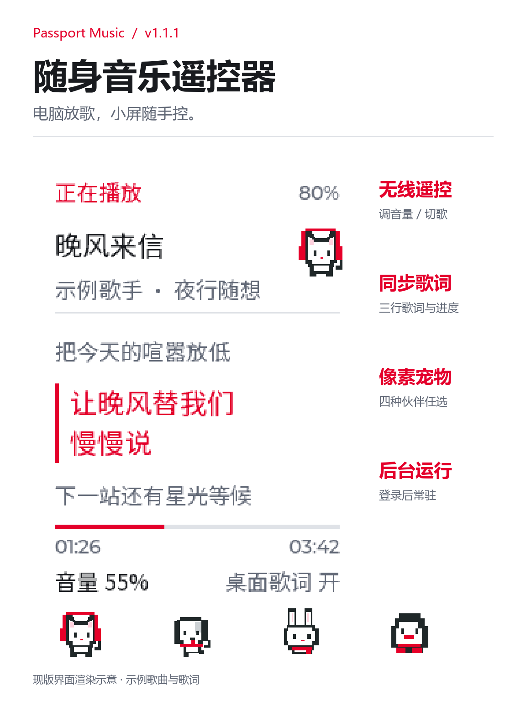

**English** · [简体中文](README.zh_CN.md)

# Passport Music

Turn AI Passport into a Bluetooth remote for NetEase Cloud Music on Windows. See the song, progress and three synchronized lyric lines. Adjust the player's own volume, skip tracks, pause playback and toggle PC desktop lyrics.

The new desktop control center brings installation, connection status and settings into one window. Start with Get Started, then use the desktop shortcut or tray icon. Device, player and lyric status are shown separately. Bring NetEase back from the tray without restarting playback.

Choose nine pixel-art backgrounds and a headphone cat, dog, rabbit or penguin. Pets move during playback and rest when paused, including inside settings. Fine-tune lyric timing, brightness and screen timeout; changes save automatically.

Requires the Windows desktop app and companion control center. Audio plays on your PC. Interface labels are Chinese.

Current interface render with sample song and lyrics.

[Nine backgrounds](docs/images/passport-music-wallpapers.png) · [Desktop control center](docs/images/passport-music-pets.png) · [Controls](docs/images/passport-music-controls.png) · [Settings](docs/images/passport-music-settings.png)

## Get started

1. Flash the play from the community.
2. Extract the PC package, open `PassportMusicControl.exe` and click Get Started.
3. Click Open NetEase and play a song.
4. Pair **Passport Music** once in Windows Bluetooth settings using the six-digit device code.

Use the desktop shortcut or tray icon afterward. Closing the window keeps the bridge running.

[Control center and firmware v1.3.1](https://github.com/wyh1351/passport-music/releases/tag/v1.3.1) · [Full instructions](docs/netease-music.md)

## Controls

| Key | Tap | Double-tap | Hold |
| --- | --- | --- | --- |
| UP | App volume +5 | +20 | Previous track |
| DOWN | App volume -5 | -20 | Next track |
| OK | Play/pause | PC desktop lyrics on/off | Settings |

Volume steps are percentage points. In settings, UP/DOWN selects, tap OK enters/returns and hold OK goes home.

## Compatibility

Requires Windows, Bluetooth and the NetEase desktop app; tested with 3.1.31.205174. Menus are Chinese. Chinese/Latin, Japanese kana and modern Korean are supported; other scripts and emoji may not render. If a client update breaks control, try reopening it with the companion launcher.

## Build from source

On Windows with Python 3.12, run `python -m pip install -r companion/requirements-gui.txt pyinstaller==6.22.3`, then `python tools/build_windows_companion.py --output dist/PassportMusic`. Choose a new output folder. For long project paths, use a short output path and `--work-dir C:/Temp`. The builder does not package local settings or logs.

For firmware, activate ESP-IDF 5.5.3 and run `./tools/validate.sh --firmware`. The verified merged image is `build/FoloToy-AI-Passport-full.bin`, for flashing at 0x0. See the [build guide](docs/development/engineering/build-and-test.md) for environment and debug archive details.

## Credits and license

Based on [FoloToy AI Passport](https://gitee.com/FoloToy/ai-passport). See [LICENSE](LICENSE) and [asset documentation](assets/README.md) for project and third-party font licensing.
