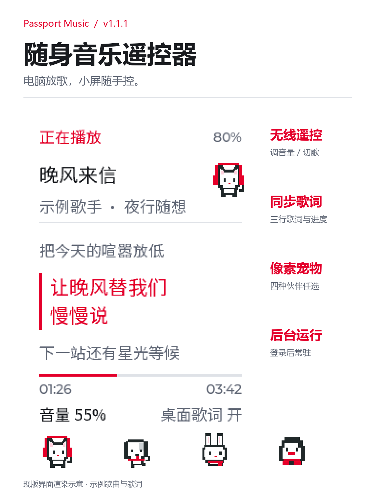

[English](README.md) · **简体中文**

# 随身音乐遥控器

把 AI Passport 变成电脑网易云音乐的无线遥控器：抬手看歌名、进度和三行同步歌词，按键调节网易云内部音量、切歌、播放暂停，还能开关电脑桌面歌词。

九款像素背景随心换，播放页和设置页保持一致，也能切回“默认”白底。耳机猫、小狗、小兔、企鹅任选，播放时轻晃、暂停时闭眼，也可以不显示。

背景、宠物、歌词快慢、屏幕亮度和自动息屏都能在设备上调整，重启后保留。电脑桥接支持登录后后台运行，日常打开已配置的网易云就能用。

适用 Windows 桌面版网易云音乐，需配套桥接；声音由电脑播放。

现版界面渲染，歌曲与歌词为演示内容。

[九款背景](docs/images/passport-music-wallpapers.png) · [四种宠物](docs/images/passport-music-pets.png) · [按键](docs/images/passport-music-controls.png) · [设置](docs/images/passport-music-settings.png)

## 开始使用

1. 在社区刷入本玩法固件。
2. 下载并解压 Windows 桥接，运行 `Enable-Autostart.cmd`。
3. 完全退出网易云，再用 `Open-NetEase-Remote.cmd` 打开。
4. 在 Windows 蓝牙设置中配对 **Passport Music**，输入设备上的六位码。

[Windows 桥接 v1.2.1](https://github.com/wyh1351/passport-music/releases/tag/bridge-v1.2.1) · [固件下载](https://github.com/wyh1351/passport-music/releases/latest) · [完整使用说明](docs/netease-music.zh_CN.md)

## 按键

| 按键 | 短按 | 双击 | 长按 |
| --- | --- | --- | --- |
| 上 | 网易云音量 +5 | +20 | 上一首 |
| 下 | 网易云音量 -5 | -20 | 下一首 |
| 确定 | 播放/暂停 | 开关电脑桌面歌词 | 设置 |

音量数字为百分点。设置中上下选择，短按确定进入或返回，长按确定回主页。

## 兼容性

需要 Windows、蓝牙和网易云桌面版；已验证 3.1.31.205174。菜单为中文，支持中文/西文、日文假名和现代韩文；其他文字或表情可能不显示。网易云更新后若控制失效，先用配套启动器重新打开。

## 来源与许可

基于 [FoloToy AI Passport](https://gitee.com/FoloToy/ai-passport) 开发。项目许可与第三方字体说明见 [LICENSE](LICENSE) 和 [素材说明](assets/README.zh_CN.md)。
